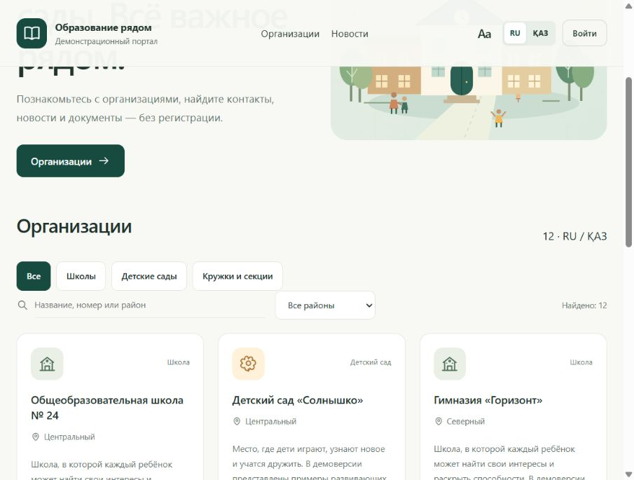

# G-TON А-2 — сайты школ и детских садов

Макет работы сервиса на основе `MrAngelskye/hakaton2`: публичные страницы на RU/ҚАЗ и закрытые кабинеты сотрудников. Детские сады имеют возрастные группы, режим дня и раздел для родителей; школы — обучение и программы. Все данные учебные; связи с организациями и реальных интеграций нет.



**Быстрый запуск:** откройте `edu-portal/start-portal.cmd` на Windows или выполните:

```sh
cd edu-portal
python server.py
```

Адрес: `http://127.0.0.1:4173/`. Зависимости: Python 3.10+, внешние пакеты не нужны. Для демо сотрудника садика — `teacher-garden`, администратора — `admin`; пароль `Demo2026!`. Эти аккаунты предназначены только для локального показа.

Подробности: [запуск и возможности](edu-portal/README.md), [задача с разных сторон](docs/MVP-PLAN.md), [сценарий демонстрации](docs/DEMO.md), [проверки и ограничения](docs/VALIDATION.md).

Проверить:

```sh
python -m unittest discover -s edu-portal/tests -v
node --test edu-portal/tests/test_frontend_review.js
```

Собрать исходники в ZIP:

```sh
python scripts/package.py
```

База, пароли из локальных настроек и файлы настроек не включаются в Git или ZIP. Данные всех организаций в демо вымышленные. Это готовая демонстрационная версия; серверный пилот и проверка масштаба 600 организаций ещё предстоят.

[Пользовательский и технический аудит](docs/USER-DEVELOPER-AUDIT.md): найденные проблемы, исправления и ограничения. После исправлений прошли 32 HTTP-теста и 15 проверок клиентского кода.
