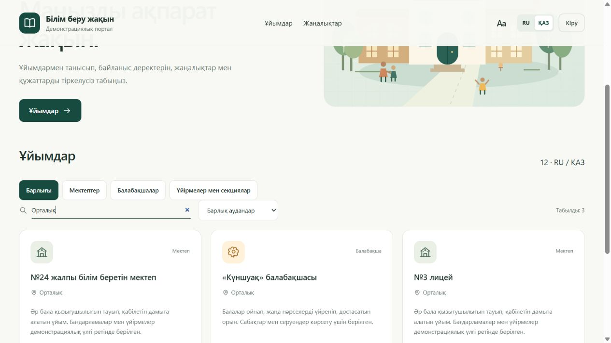
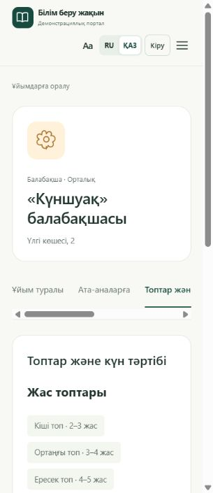

# Пользовательский и технический аудит MVP

Проверено 12 октября 2026 года. Исходная версия: `41ea86b`. Все действия выполнялись на отдельных локальных учебных базах. Реальные школы, садики и внешние системы не участвовали; сообщений и обращений организациям не было.

Основной агент прошёл пользовательские сценарии в браузере и проверил изменения. Отдельному агенту поручили независимый аудит и исправления в роли senior-разработчика. После его работы основной агент отдельно запустил полный набор тестов и повторил ключевые сценарии.

## Подтверждённые проблемы и исправления

P1 — исправить в первую очередь; P2 — влияет на защиту или рабочий сценарий; P3 — мешает удобству чтения. Это приоритеты для данного макета, а не оценка ущерба промышленной системе.

| Код | Приоритет | Что было до исправления | Что изменено и как проверено |
| --- | --- | --- | --- |
| S1 | P1 | Сервер принимал произвольный Host. С `rebinding.invalid:<порт>` и таким же Origin можно было получить публичный API и войти в демонстрационный аккаунт администратора. | Разрешены только явно заданные адреса и фактический порт сервера. Чужой Host получает 403 на чтении и записи. Проверено через HTTP. Это устраняет предпосылку DNS rebinding; полноценную атаку с DNS и браузером не разыгрывали. |
| S2 | P2 | Одиночный Unicode-surrogate, например `\ud800` в пароле или тексте, обрывал HTTP-ответ с ошибкой кодирования. | Все строки и ключи JSON проверяются до записи или вычисления хеша. Некорректный текст получает 400; содержимое базы не меняется. |
| S3 | P2 | JSON с 5000 вложенных массивов обрывал ответ из-за глубины рекурсии. | Ошибки разбора обработаны; вложенность ограничена 32 уровнями, NaN и бесконечности отвергаются. Проверены ответы 400 и работоспособность следующего обычного запроса. |
| S4 | P2 | Некорректный адрес запроса `http://[bad` обрывал ответ. | Сервер проверяет адрес до маршрутизации и возвращает 400. Проверены GET и POST. |
| S5 | P2 | Лимит входа можно было обходить сменой логина: 33 разных логина дали 33 ответа 401. | Добавлен общий лимит по IP: после 32 попыток за минуту — 429. Старый лимит восьми попыток на сочетание логина и IP сохранён. Проверены последовательные и параллельные попытки. |
| S6 | P2 | Вход принимался с оборванным телом, двумя Content-Length или одновременно Content-Length и Transfer-Encoding. | Такие запросы получают 400 до входа. Это исправление обработки HTTP-запросов; эксплуатацию через прокси и request smuggling не проверяли. |
| F1 | P2 | Поиск «Орталық» давал ноль результатов, хотя в каталоге есть организации этого района. | Поиск учитывает названия района на RU и ҚАЗ независимо от языка интерфейса. Браузерный повтор: три результата. |
| F2 | P2 | При ширине 320 пикселей шапка выходила за экран: ширина страницы 334 при доступных 305. Кнопка меню была за краем. | Добавлен перенос и ограничение ширины элементов шапки. При 320 пикселях: 305/305; при 390: 375/375. Проверены увеличенный текст и открытие меню. Прокрутка длинного ряда вкладок внутри своего контейнера сохранена. |
| F3 | P2 | Переключение языка стирало несохранённый текст формы. Переходы не предупреждали о потере изменений. | Смена языка обновляет оболочку и сохраняет форму. Добавлены предупреждения при переходе, выходе и закрытии страницы. В браузере подтверждены сохранность текста и появление предупреждения; отмена, история браузера, выбранный файл и успешное/неуспешное сохранение дополнительно проверены в Node. |
| F4 | P3 | Дата в казахской версии могла отображаться как «2026 M10 12» из-за неполных данных Intl в браузере. | Используются явные казахские названия месяцев: «12 қазан 2026». Проверены дата и обработка неверного значения. |
| F5 | P2 | Открытая вкладка использовала старый каталог: новая публикация не появлялась при переходе между разделами, архивные карточки оставались до перезагрузки. | Публичные данные обновляются при навигации. Поздний ответ старого перехода не заменяет более новую страницу. В браузере новая новость появилась после перехода «Родителям → Новости» без перезагрузки; после архива исчезла. |
| F6 | P2 | Две формы отправляли полную старую организацию: сохранение раздела родителей могло затереть уже сохранённый телефон другого редактора. | Кабинет отправляет только изменённые поля через PATCH. Сервер объединяет их с актуальными данными в транзакции. Проверены разные разделы и два одновременных запроса; оба изменения сохранились. Сохранение раздела также проверено в браузере. |
| F7 | P2 | Кнопка увеличения текста меняла переменную на body, но размер шрифта корневого элемента и значения rem оставались прежними. | Размер задаётся корневому элементу. Браузерный повтор: обычный текст 16px, увеличенный 18px; горизонтального переполнения при 320/390 пикселях нет. |

При проверке исправлений также устранена новая потенциальная гонка: поздний ответ сохранения старой формы не снимает признак несохранённых изменений с новой формы. Этот случай имеет отдельный регрессионный тест.

## Пользовательские сценарии, которые прошли

- Чтение каталога и страниц школ/садиков без входа, русский и казахский языки, поиск и фильтры.
- Разделы садика с возрастными группами, режимом дня и сведениями родителям.
- Неверный пароль показывает понятную ошибку; сотрудник садика не открывает кабинет школы.
- Создание черновика новости, редактирование, публикация, открытие на публичной странице, архивирование.
- HTML в заголовке и тексте отображается как обычный текст: элементы script и тестовое изображение в статье не создаются.
- Выход из аккаунта в одной вкладке убирает закрытый кабинет в другой вкладке.
- Текст формы сохраняется при смене языка; изменённый раздел успешно сохраняется через новый PATCH.
- Узкие экраны, увеличение текста и открытие мобильного меню.

Загрузка/скачивание файлов, управление аккаунтами и запрет доступа к чужим материалам дополнительно покрыты HTTP-тестами. Подробности прежней ручной проверки реальной загрузки TXT находятся в [VALIDATION.md](VALIDATION.md); в этом аудите её не повторяли, поскольку обработчик загрузки не менялся.

## Независимая проверка после исправлений

Windows, Python 3.12.14, Node.js 24.19.0:

```sh
python -m unittest discover -s edu-portal/tests -v
node --test edu-portal/tests/test_frontend_review.js
node --check edu-portal/dist/app.js
```

- 32/32 HTTP-теста: прежние 19 и 13 новых.
- 15/15 регрессионных проверок реального клиентского кода в изолированном контексте Node. Это не полноценная эмуляция браузера; размеры экрана отдельно проверены в настоящем браузере.
- Синтаксис JavaScript проверен.
- Тестовые базы не входят в Git или архив исходников.
- Архив из 43 файлов прошёл проверку целостности и запуск из чистой распаковки: 12 организаций, включая четыре садика; главная страница, JavaScript и CSS возвращают 200. Рабочая база и локальные настройки в него не включены.

Полные результаты: [HTTP](../artifacts/audit/http-tests.txt), [клиентский код](../artifacts/audit/frontend-tests.txt), [сводка](../artifacts/audit-results.json).

## Что остаётся ограничением макета

- При одновременном изменении одного поля сохраняется последнее значение. Истории версий и решения конфликтов пока нет. Старый PUT полностью заменяет сведения; сторонний клиент должен сам учитывать эту семантику.
- Ограничитель входа находится в памяти одного процесса и сбрасывается после перезапуска; 32 попытки учитываются для общего IP. Это достаточная демонстрационная защита, но не распределённая система ограничения запросов.
- Непрерывных обновлений нет: свежие публикации загружаются при переходе между разделами или перезагрузке.
- Демонстрационные пароли известны из исходников. Приложение рассчитано на локальный показ с вымышленными данными.
- Полный аудит безопасности, нагрузка на 600 организаций, проверка доступности по стандартам, антивирус, резервное восстановление и промышленное размещение не выполнялись. Проверка сигнатуры PDF не доказывает безопасность содержимого.

## Снимки проверок

Поиск после исправления:



Шапка садика после исправления на экране 320 пикселей:


